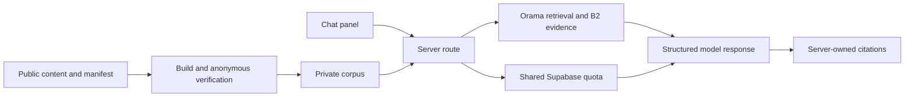

# Portfolio AI source kit

Portfolio AI adds an assistant that answers from selected pages on your own portfolio and links to its sources. Use your own public content with the kit or explore the fictional Atlas example.

- [Hosted assistant](#hosted-assistant) deploys a separate service and adds it to a public portfolio with one script.
- [Vite local preview](#vite-local-preview) runs the assistant on your development machine while you keep your existing Vite portfolio.
- [Next.js App Router installation](#install-into-your-nextjs-portfolio) uses the released `v1.1.0` registry item and supports deployment through the Next.js integration.

## Hosted assistant

Use this route for a public HTTPS portfolio that allows an embedded script and frame. The assistant runs in its own project and uses the pages you approve.

[](https://vercel.com/new/clone?repository-url=https%3A%2F%2Fgithub.com%2Fvincentlow02%2Fportfolio-ai-source-kit%2Ftree%2Fhosted-assistant-template&env=PORTFOLIO_SITE_ORIGIN%2CPORTFOLIO_SOURCE_PATHS&project-name=portfolio-ai-assistant)

1. Set `PORTFOLIO_SITE_ORIGIN` to your portfolio's canonical HTTPS origin, such as `https://www.example.com`. Set `PORTFOLIO_SOURCE_PATHS` to the exact paths you approve, such as `/,/projects,/projects/field-notes`. The build generates a private knowledge file from those pages. Each page needs an anonymous HTTP 200, a supported HTML language, and visible `<main>` text that renders using same-origin scripts and styles. Read the Vite preview section below for content limits.
2. Copy the assistant's HTTPS deployment origin into this script and add it to your portfolio HTML before `</body>`. Publish your portfolio with the script in place.

   ```html
   <script src="https://your-assistant.example.com/embed.js" defer></script>
   ```

3. Open your public portfolio, choose **Ask about this portfolio**, and ask about a distinctive term from an approved page. Confirm the answer includes a **Source** link pointing back to that page. Redeploy the assistant to refresh the knowledge base after updating the source pages.

If a Vite portfolio page opens through site navigation but its direct URL returns 404, configure your host to serve the app at that URL before selecting it. For a Vite SPA on Vercel, see [the deep-link rewrite instructions](https://vercel.com/docs/frameworks/frontend/vite#using-vite-to-make-spas).

The default hosted mode returns source passages using local retrieval, with no model account required. To enable generated Qwen answers, copy the settings shown in the [environment template](.env.example) to your assistant project's environment, apply the [quota migration](supabase/migrations/202611100001_vincent_ai_analytics.sql) to a dedicated Supabase project, and set `PORTFOLIO_HOSTED_MODEL=1`. Configure the model, region, rate limits and budget using the [security and quota guide](docs/security.md). The assistant reserves shared quota before making a model call. It sends the question and selected approved passages to Qwen. Keep provider keys and quota credentials in the assistant project's server environment.

### Refresh the knowledge base

After publishing changes to your portfolio, redeploy the assistant's production deployment to refresh manually. The build rereads the exact `PORTFOLIO_SOURCE_PATHS` allowlist from the public portfolio. Update that list yourself when adding or removing a source. Vercel replaces the active assistant only after a successful production build. If capture or the build fails, check the assistant's deployment logs and retry after fixing the issue. The last successful deployment keeps serving. See [Vercel production promotions](https://vercel.com/docs/deployments/promoting-a-deployment).

**Optional automatic refresh.** Connect the assistant project to a Git repository that contains the hosted Kit. Create a [Vercel Deploy Hook](https://vercel.com/docs/deploy-hooks) for the assistant project's production branch. Keep the hook URL in your publishing system's secrets. Each successful trigger queues a new assistant build with the existing source settings.

- **Vercel with GitHub**. Copy the [refresh workflow](examples/refresh-portfolio-knowledge.yml) into `.github/workflows/refresh-portfolio-knowledge.yml` on the **portfolio repository's default branch**. Set the Actions repository variable `PORTFOLIO_VERCEL_PROJECT_ID` to the portfolio project's ID, and the Actions secret `PORTFOLIO_AI_DEPLOY_HOOK_URL` to the assistant's hook URL. A promotion of that portfolio project to production queues a refresh. To go back to manual refresh, disable the workflow in GitHub Actions. See [Vercel's GitHub deployment events](https://vercel.com/docs/git/vercel-for-github#repository-dispatch-events).
- **Other hosting or CI**. In the step that runs after the new portfolio version is serving on its production URL, send one POST to the assistant's Deploy Hook. Load the URL from a CI secret and avoid logging it.

  ```sh
  curl --silent --fail --max-time 20 --output /dev/null --request POST -- "$PORTFOLIO_AI_DEPLOY_HOOK_URL"
  ```

## Vite local preview

You'll need an existing Vite portfolio, Git, Node.js 24, npm, and Chromium. On Windows PowerShell, use `npm.cmd` if the `npm` script is blocked.

### 1. Start your portfolio

Open a terminal in your **Vite portfolio**. Install its dependencies using its usual setup, then start the dev server:

```sh
npm run dev -- --host 127.0.0.1 --port 5173 --strictPort
```

Open `http://127.0.0.1:5173` and check that a page you want to include, such as `/projects`, displays its content. Keep this terminal running. If you choose a different port, use it for the browser URL and the capture command below.

### 2. Create the knowledge base

Open a second terminal and clone the **Kit** into a directory beside your portfolio:

```sh
git clone --branch feat/local-portfolio-preview https://github.com/vincentlow02/portfolio-ai-source-kit.git
cd portfolio-ai-source-kit
npm ci
npm run preview:local -- --origin http://127.0.0.1:5173 --path /projects
```

Replace `/projects` with a public page you approve for the assistant. Repeat `--path` to include more pages. A successful run prints `Local knowledge preview` with the page and passage counts and saves `.portfolio-knowledge/local-preview.json`. Review the passages and their source paths in that file. Git ignores the file.

The reader captures visible text in `<main>` on pages with English, Chinese, or Japanese HTML language declarations. Use `/` or lowercase route paths with letters, digits, and hyphens, such as `/projects/field-notes`. It can load same-origin scripts and styles to render a page. The approved page's text needs to render with those resources, since capture blocks `fetch` and XHR. Protected, hidden, and `noindex` content is excluded.

### 3. Open chat inside your portfolio

From the **Kit** terminal, start the local chat service:

```sh
npm run preview:chat
```

In your **Vite portfolio's** `index.html`, add this development-only loader before `</body>`:

```html
<script type="module">
  if (import.meta.env.DEV && window.location.hostname === "127.0.0.1") {
    const chat = document.createElement("script");
    chat.src = "http://127.0.0.1:4174/embed.js";
    document.body.append(chat);
  }
</script>
```

Refresh the portfolio at `http://127.0.0.1:5173` and select **Ask about this portfolio**. Enter a distinctive term from an approved page. The answer should show a matching passage. Click **Source** to open the corresponding page on your portfolio. A question about an unrelated topic should return an insufficient-information message. This smoke test uses local search and works without model credentials or a database.

If the chat button is missing, check that both terminals are running and that your browser uses the exact `127.0.0.1` origin you captured. If you start chat with `--port`, use that port in the loader. Rebuild the knowledge base and restart chat after changing approved content or the portfolio port.

### Optional Qwen model preview

Create `.env.local` in the **Kit** directory and fill in your [Model Studio API key](https://www.alibabacloud.com/help/en/model-studio/get-api-key) and [OpenAI-compatible base URL](https://www.alibabacloud.com/help/en/model-studio/base-url) from the same region:

```dotenv
PORTFOLIO_AI_PROVIDER=qwen
QWEN_API_KEY=your-key
QWEN_BASE_URL=https://your-workspace.ap-southeast-1.maas.aliyuncs.com/compatible-mode/v1
QWEN_MODEL=qwen3.7-flash
QWEN_JSON_MODE=object
QWEN_ENABLE_THINKING=false
```

The URL above illustrates a Singapore workspace. Keep the key in the Git-ignored `.env.local` file in the Kit. Stop the chat service with `Ctrl+C` and restart it on the same port:

```sh
npm run preview:chat -- --model
```

Refresh the portfolio and check that the panel says **Model preview**. Ask a question about an approved page and check that the cited passage supports the answer. Model mode sends the question and selected approved passages to your provider and can incur charges. Both Vite preview modes bind to `127.0.0.1` for local testing.

## Try the example

Use Node.js 24, npm and a compatible Chromium installation. Copy `examples/atlas-portfolio` to a separate directory, then from the kit directory run:

```sh
node scripts/copy-portfolio-kit.mjs /absolute/path/to/atlas
cd /absolute/path/to/atlas
npm ci
npm run build
```

Copy `.env.example` in Atlas to `.env.local`, configure your own model and dedicated Supabase project, apply the supplied SQL migration, and run `npm run dev`. Never commit the local environment file. The example's `portfolio-knowledge.config.ts`, `portfolio-assistant.server.ts`, layout and API routes show the integration points.

## Install into your Next.js portfolio

For a Next.js App Router project, review the files and their targets in `registry.json`, then run from the project root:

```sh
npx -y shadcn@4.23.0 add 'vincentlow02/portfolio-ai-source-kit/portfolio-ai#v1.1.0'
```

This installs the reusable code, dependencies, example templates and `.portfolio-ai/SETUP.md`. It does not automatically change your layout, choose your sources, configure credentials, apply SQL, or publish your site. The command targets project-root paths; inspect conflicts first and do not overwrite existing files without reviewing them. Node 24, Next 16 and React 19 are the tested baseline. A Figma account is not needed.

Give your coding agent this prompt:

> Read `.portfolio-ai/SETUP.md` and integrate Portfolio AI into this portfolio. Inspect my app and propose the exact public sources and protected paths; wait for my approval before building the knowledge corpus. Use mock services for validation and report the results.

You remain responsible for approving public content, supplying your own model and dedicated Supabase credentials, reviewing the migration and testing the result before public deployment. The fictional Atlas content is an example, not your portfolio's knowledge. Keep your `.env.local` and generated corpus private. Model calls may incur provider charges.

## Manual installation

1. Run `node scripts/copy-portfolio-kit.mjs /absolute/path/to/your-app`. It refuses to overwrite existing files.
2. Add the dependencies and build script from the Atlas `package.json` to your app, while retaining your own layout and design.
3. Adapt the Atlas API routes, `portfolio-assistant.server.ts`, `next.config.ts` and panel integration in `app/layout.tsx`.
4. Declare your public sources and protected paths in a knowledge manifest based on `portfolio-knowledge.config.ts`; build with `tsx scripts/portfolio-knowledge/publish.mts`.
5. Configure server-only credentials, regional model pricing and shared quota in your own `.env.local`. Apply the included SQL migration to a dedicated project only after reviewing it. The legacy `vincent_ai` database identifiers are retained for compatibility.
6. Test citations, protected content, authorization, abuse limits and semantic accuracy against your own material before enabling public access. A valid citation link does not guarantee a model claim is factually supported.

The CI registry test installs the exact GitHub commit into both the Atlas example and an independently structured fictional portfolio; it builds, typechecks and tests interactions with fake model and quota services. It does not make paid model calls.

## Next.js sources and deployment

The builder accepts public rendered pages, Markdown, static MDX and JSON. Static MDX ingestion rejects executable expressions and JSX; use rendered pages for dynamic material. Sources must be visible anonymously at the declared same-origin URL; protected paths are excluded. Rebuild the corpus with the app after content changes.



Keep API and database secrets on the server. Configure an exact allowed HTTPS origin, shared quota and provider-side spend controls. Atlas includes basic security headers in `next.config.ts`; adapt them to your host and test them in deployment. On Vercel Preview, independently verify platform Deployment Protection before enabling chat; an origin check is not authentication. Default public access is disabled. Model output is untrusted and still needs human evaluation; heuristic validation cannot guarantee semantic correctness.

See the [integration guide](docs/integration.md), [architecture](docs/architecture.md), [security and deployment](docs/security.md), and [evaluation and troubleshooting](docs/evaluation.md) for details on the Next.js integration.

## License and dependencies

The kit and fictional example are covered by the accompanying [MIT license](LICENSE). Dependencies are installed separately; preserve their applicable licenses and notices. See [third-party notices](THIRD_PARTY_NOTICES.md) and the example lockfile. No original portfolio assets are included.
