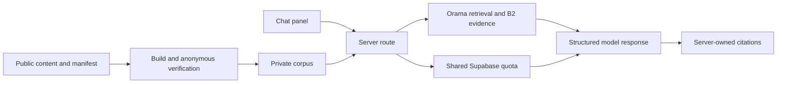

# Portfolio AI source kit

This source kit adds a citation-aware assistant to a Next.js App Router portfolio. It contains reusable code and the fictional Atlas example. It does not contain a portfolio owner's personal materials; supply your own public content and assets.

Read the [integration guide](docs/integration.md), [RAG architecture](docs/architecture.md), [security and deployment](docs/security.md), and [evaluation and troubleshooting](docs/evaluation.md) for the complete setup.

## Try the example

Use Node.js 24, npm and a compatible Chromium installation. Copy `examples/atlas-portfolio` to a separate directory, then from the kit directory run:

```sh
node scripts/copy-portfolio-kit.mjs /absolute/path/to/atlas
cd /absolute/path/to/atlas
npm ci
npm run build
```

Copy `.env.example` in Atlas to `.env.local`, configure your own model and dedicated Supabase project, apply the supplied SQL migration, and run `npm run dev`. Never commit the local environment file. The example's `portfolio-knowledge.config.ts`, `portfolio-assistant.server.ts`, layout and API routes show the integration points.

## Add to your own portfolio

1. Run `node scripts/copy-portfolio-kit.mjs /absolute/path/to/your-app`. It refuses to overwrite existing files.
2. Add the dependencies and build script from the Atlas `package.json` to your app, while retaining your own layout and design.
3. Adapt the Atlas API routes, `portfolio-assistant.server.ts`, `next.config.ts` and panel integration in `app/layout.tsx`.
4. Declare your public sources and protected paths in a knowledge manifest based on `portfolio-knowledge.config.ts`; build with `tsx scripts/portfolio-knowledge/publish.mts`.
5. Configure server-only credentials, regional model pricing and shared quota in your own `.env.local`. Apply the included SQL migration to a dedicated project only after reviewing it. The legacy `vincent_ai` database identifiers are retained for compatibility.
6. Test citations, protected content, authorization, abuse limits and semantic accuracy against your own material before enabling public access. A valid citation link does not guarantee a model claim is factually supported.

## Sources and deployment

The builder accepts public rendered pages, Markdown, static MDX and JSON. Static MDX ingestion rejects executable expressions and JSX; use rendered pages for dynamic material. Sources must be visible anonymously at the declared same-origin URL; protected paths are excluded. Rebuild the corpus with the app after content changes.



Keep API and database secrets on the server. Configure an exact allowed HTTPS origin, shared quota and provider-side spend controls. Atlas includes basic security headers in `next.config.ts`; adapt them to your host and test them in deployment. On Vercel Preview, independently verify platform Deployment Protection before enabling chat; an origin check is not authentication. Default public access is disabled. Model output is untrusted and still needs human evaluation; heuristic validation cannot guarantee semantic correctness.

## License and dependencies

The kit and fictional example are covered by the accompanying MIT license. Dependencies are installed separately; preserve their applicable licenses and notices. The example lockfile identifies exact dependency versions. Major direct dependencies include the Apache-2.0 licensed AI SDK, Orama and Puppeteer, MIT licensed Next.js, React, unified, remark and Zod, and ISC licensed Lucide. Check transitive notices for your actual distribution. No original portfolio assets are included.
