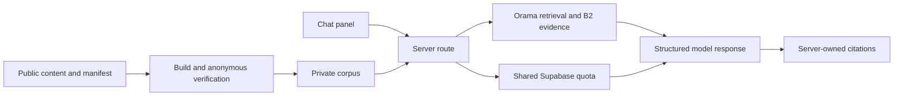

# Portfolio AI source kit

This source kit adds a citation-aware assistant to a Next.js App Router portfolio. It contains reusable code and the fictional Atlas example. It does not contain a portfolio owner's personal materials; supply your own public content and assets.

Read the [integration guide](docs/integration.md), [RAG architecture](docs/architecture.md), [security and deployment](docs/security.md), and [evaluation and troubleshooting](docs/evaluation.md) for the complete setup.

## Quick start

1. Review `registry.json` and destination conflicts, then install the reviewed source into your Next.js App Router project. Pin the ref to a full commit SHA for reproducibility; `main` below tracks the latest source and can change. An unattended overwrite prompt can exit successfully before installation finishes; check the output. A missing doctor means the install is incomplete.

   ```sh
   npx -y shadcn@4.23.0 add 'vincentlow02/portfolio-ai-source-kit/portfolio-ai#main'
   ```

2. Ask your coding agent to read `.agents/skills/portfolio-ai-install/SKILL.md` and `.portfolio-ai/SETUP.md`, inspect your project, and propose public sources and protected paths. Approve the list before it builds the corpus.
3. Run `node scripts/portfolio-chat/doctor.mjs`, configure your own services, and test the integration with mocks. Review source citations, privacy, access and quotas before enabling public access. See [getting started](docs/getting-started.md) and [AI services setup](docs/ai-services-setup.md).

The three steps require a source revision that includes the skill and doctor. The stable v1.1.0 tag remains available below and predates those additions.

## Try the example

Use Node.js 24, npm and a compatible Chromium installation. Copy `examples/atlas-portfolio` to a separate directory, then from the kit directory run:

```sh
node scripts/copy-portfolio-kit.mjs /absolute/path/to/atlas
cd /absolute/path/to/atlas
npm ci
npm run build
```

Copy `.env.example` in Atlas to `.env.local`, configure your own model and dedicated Supabase project, apply the supplied SQL migration, and run `npm run dev`. Never commit the local environment file. The example's `portfolio-knowledge.config.ts`, `portfolio-assistant.server.ts`, layout and API routes show the integration points.

## Install into your own portfolio

For a Next.js App Router project, review the files and their targets in `registry.json`, then run from the project root:

```sh
npx -y shadcn@4.23.0 add 'vincentlow02/portfolio-ai-source-kit/portfolio-ai#v1.1.0'
```

This installs the reusable code, dependencies, example templates and `.portfolio-ai/SETUP.md`. It does not automatically change your layout, choose your sources, configure credentials, apply SQL, or publish your site. The command targets project-root paths; inspect conflicts first and do not overwrite existing files without reviewing them. Node 24, Next 16 and React 19 are the tested baseline. A Figma account is not needed.

Give your coding agent this prompt:

> Read `.portfolio-ai/SETUP.md` and integrate Portfolio AI into this portfolio. Inspect my app and propose the exact public sources and protected paths; wait for my approval before building the knowledge corpus. Use mock services for validation and report the results.

You remain responsible for approving public content, supplying your own model and dedicated Supabase credentials, reviewing the migration and testing the result before public deployment. The fictional Atlas content is an example, not your portfolio's knowledge. Keep your `.env.local` and generated corpus private. Model calls may incur provider charges.

## Manual installation

1. Run `node scripts/copy-portfolio-kit.mjs /absolute/path/to/your-app`. It refuses to overwrite existing files.
2. Add the dependencies and build script from the Atlas `package.json` to your app, while retaining your own layout and design.
3. Adapt the Atlas API routes, `portfolio-assistant.server.ts`, `next.config.ts` and panel integration in `app/layout.tsx`.
4. Declare your public sources and protected paths in a knowledge manifest based on `portfolio-knowledge.config.ts`; build with `tsx scripts/portfolio-knowledge/publish.mts`.
5. Configure server-only credentials, regional model pricing and shared quota in your own `.env.local`. Apply the included SQL migration to a dedicated project only after reviewing it. The legacy `vincent_ai` database identifiers are retained for compatibility.
6. Test citations, protected content, authorization, abuse limits and semantic accuracy against your own material before enabling public access. A valid citation link does not guarantee a model claim is factually supported.

The CI registry test installs the exact GitHub commit into Atlas, an independent fictional portfolio and an initially unmodified cold-start host. It builds, typechecks and tests interactions with fake model and quota services. The cold-start test applies explicit simulated integration edits; it does not test a live coding agent. It does not make paid model calls.

## Sources and deployment

The builder accepts public rendered pages, Markdown, static MDX and JSON. Static MDX ingestion rejects executable expressions and JSX; use rendered pages for dynamic material. Sources must be visible anonymously at the declared same-origin URL; protected paths are excluded. Rebuild the corpus with the app after content changes.



Keep API and database secrets on the server. Configure an exact allowed HTTPS origin, shared quota and provider-side spend controls. Atlas includes basic security headers in `next.config.ts`; adapt them to your host and test them in deployment. On Vercel Preview, independently verify platform Deployment Protection before enabling chat; an origin check is not authentication. Default public access is disabled. Model output is untrusted and still needs human evaluation; heuristic validation cannot guarantee semantic correctness.

## License and dependencies

The kit and fictional example are covered by the accompanying [MIT license](LICENSE). Dependencies are installed separately; preserve their applicable licenses and notices. See [third-party notices](THIRD_PARTY_NOTICES.md) and the example lockfile. No original portfolio assets are included.

The [original Figma UI reference](https://www.figma.com/design/DxOQI6Z0YQp5LxZNkufTBX/Portfolio-AI-Chat-UI-Gallery?node-id=7-2) is optional and is not needed to install or run the kit. See the [fictional demo plan](docs/demo-plan.md), [contribution guide](CONTRIBUTING.md), and [vulnerability reporting](SECURITY.md).
