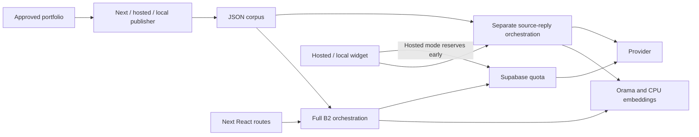

# Architecture V2 reference decisions

Baseline: `4fcfcf39f2fdd6cc812e94a5454d0993aa592f04`, clean `feat/hybrid-retrieval` checkout. The implementation branch is `fix` in an independent clone because the original clone already owns a `fix/*` local ref.

| Reference | Applicable principle | Decision for the source kit |
| --- | --- | --- |
| [Haystack DocumentJoiner and implementation](https://docs.haystack.deepset.ai/docs/documentjoiner) | Give hybrid retrieval an explicit join/score boundary and deduplicate by identity. | Keep Orama and MiniLM. Carry match eligibility separately from scores and record explicit evidence additions. Evaluate weights before changing them. |
| [LlamaIndex Condense Plus Context](https://developers.llamaindex.ai/python/examples/chat_engine/chat_engine_condense_plus_context/) and [citation engine](https://github.com/run-llama/llama_index/blob/main/llama-index-core/llama_index/core/query_engine/citation_query_engine.py) | Resolve a follow-up into a usable query before retrieval. Build citations from retrieved nodes. | Use deterministic context only when the turn references history. Retain per-request evidence keys and the server-owned source table. Skip an extra rewrite call. |
| [Microsoft Azure RAG evaluation](https://github.com/Azure-Samples/azure-search-openai-demo/blob/main/docs/evaluation.md) and [query routing](https://github.com/Azure-Samples/azure-search-openai-demo/blob/main/docs/customization.md) | Measure retrieval, citation matches and answer quality separately using labeled examples. | Use frozen fictional cases and holdout data. Measure candidates and final evidence separately. An offline test cannot certify generation quality. Avoid Azure services and agentic search. |
| [Open WebUI retrieval implementation](https://github.com/open-webui/open-webui/blob/main/backend/open_webui/retrieval/utils.py) | Filter access before retrieval and keep thresholds, rank and source metadata explicit. | Apply the publication policy before indexing and keep narrow metadata in the prompt. Avoid reranking or full-document injection without measured benefit. |
| [AnythingLLM RAG lifecycle](https://github.com/Mintplex-Labs/anythingllm-docs/blob/main/pages/chatting-with-documents/rag-in-anythingllm.mdx) and [chat implementation](https://github.com/Mintplex-Labs/anything-llm/blob/master/server/utils/chats/stream.js) | Distinguish document ingestion from the per-visit context assembled from ranked snippets. | Keep immutable JSON snapshots and cache by snapshot identity. Deletion or revocation requires publishing a new snapshot and replacing deployed instances. No persistent vector DB. |
| [Vercel AI SDK generateText](https://ai-sdk.dev/docs/reference/ai-sdk-core/generate-text) and [settings](https://ai-sdk.dev/docs/ai-sdk-core/settings) | One SDK boundary owns output parsing, cancellation, deadlines, retry and usage. | Share executor with the pinned SDK. Keep provider restrictions and no retries. Preserve current public HTTP serialization. |
| [OWASP RAG Security](https://cheatsheetseries.owasp.org/cheatsheets/RAG_Security_Cheat_Sheet.html) | Track provenance, preserve authorization and validate untrusted input/output at every boundary. | Keep schema checks, source scope, protected paths, prompt data delimiters and request limits. Require human judgment for factual entailment. No hidden contexts or raw conversation telemetry. |

## Baseline code audit

- **Confirmed defect:** both B2 and the widget generator sort unqualified candidates at zero and can append them to the prompt. Compare `retrieval.ts::createEvidenceRetriever` to `b2.ts::buildB2Pack` and `source-reply.ts::createModelReply`.
- **Confirmed defect:** the Next catalog is computed only after a billable call, and hosted quota precedes Guardian/retrieval. See `handler.ts` and `hosted-assistant.ts`.
- **Confirmed defect:** build-time protected-source overlap is checked after declared public files/pages are read by the Next publisher. See `publish.mts` and `contract.ts`.
- **Architectural risk:** hosted excerpts run local CPU retrieval without application capacity limits. Widget cancellation does not reach generation, and the widget sends no history.
- **Performance question:** the first query embeds all passages and runtime instances cache in memory. Measure CPU/memory before choosing a deployment artifact. A cached public passage cannot outlive its snapshot identity.
- **Maintainability:** HTTP transport and answer policy are interleaved; widget assets sit below a development script path and are traced in production. Preserve compatibility targets while extracting real boundaries.
- **No change required without evidence:** retain exact existing locale tokenizers, SQL locking and 100k+700 conservative reservation, supported provider gating, Next/Registry scripts and JSON format.
