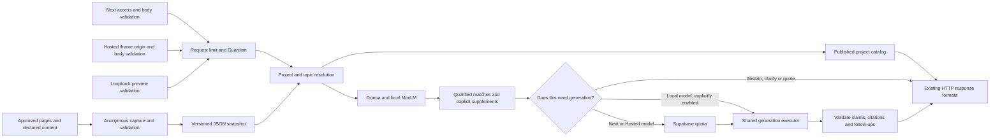

# Portfolio AI internal architecture V2

This kit delivers a React panel inside a Next.js portfolio and an iframe widget for a local Vite preview or a standalone Hosted Assistant. The three entry points share the public corpus schema, hybrid retrieval, and the generation executor. Next.js also exposes server-owned claim evidence keys, recommendations and usage metadata. The widget keeps its existing answer, links and follow-up response.

## Request flow

Read the [baseline architecture diagram and reference decisions](architecture-v2-research.md#baseline-code-audit) for the original implementation.

- `handler.ts`, `hosted-assistant.ts` and `preview-local.mts` own HTTP access, body limits, runtime configuration and serialization. Next retains the 10-request fixed window and two active requests per process. Hosted and local preview cap the process at 60 requests per minute and two active requests. Supabase model reservations remain atomic across replicas.
- `retrieval.ts` identifies public candidates and qualified matches. It combines Orama keyword scores and normalized MiniLM cosine scores, caches the in-flight corpus embedding by snapshot, and retries invalid batches on a later request. If the encoder is unavailable, a unique literal match can still qualify. Keyword-only fuzzy results stay outside the pack.
- `b2.ts` assigns the intent and assembles evidence. Each inclusion is a qualified match or has an explicit reason such as a verified selection, approved catalog, generic project comparison or scoped validation follow-up. Chunks retain the original 3,000-byte maximum, with an 18-entry and 18,000-byte total pack limit.
- `answer-engine.ts` returns deterministic catalogs, scoped clarifications and insufficient-evidence messages as early as the answer permits. Hosted and Vite can generate from relevant catalog prose when capture only has generic pages. A structured project directory remains deterministic. Conversation context comes from earlier visitor turns and uses bounded topic hints for elliptical questions. The iframe retains up to two recent complete turns in memory and discards them on reset.
- `generation.ts` sends the shared Vercel AI SDK request with a 45-second deadline, caller cancellation, a 700-token cap and zero retries. It preserves provider-specific JSON modes and captures reported token usage for valid and malformed billable responses. The Next adapter reserves conservative quota for 100,000 input tokens and 700 output tokens only when it will send generation. Hosted uses the same reservation. The local preview keeps its opt-in development model mode.
- `answer-schema.ts` defines structural output. `grounding.ts` binds citations to eligible evidence and a public source in the current corpus. Portfolio-specific exact-evidence patterns and audience terms live in `engine-config.ts`. English lexical evidence checks and attribution protections are heuristic. Review claim-level factual entailment manually where accuracy matters.
- `timing.ts` collects opt-in aggregate Next diagnostics. The offline benchmark uses the same retrieval timing boundary and records encoder, query, keyword, semantic and assembly timings. Telemetry carries numeric timing and token counts without conversation or corpus text.

## Update or remove portfolio knowledge

Next hosts declare public pages and protected paths in `portfolio-knowledge.config.ts`. The source plan rejects conflicting declarations before capture or local file reads. Vite and Hosted use approved paths and anonymous capture, with approved content on ordinary pages supported without extra metadata. Keep protected and unpublished content outside approved paths. The build binds source URLs and section anchors to verified public pages.

Run the appropriate publisher after a text change, removal or access change. The publisher generates stable IDs per source/section, a schema-v1 digest over the canonical knowledge fields, and a snapshot-specific build version. Next checks the current `.next/BUILD_ID`, rejects a mismatched snapshot and tests the completed artifact against its private HTTP path in a loopback preview. A failed validation keeps the previous artifact where one exists. A rebuilt Next application will still reject a previous snapshot whose build ID differs. Hosted and Vite replace their capture files with a completed JSON artifact. The next process loads the new publication. Replace deployed instances that still hold the old snapshot to enforce revocation. Restart the Vite chat process after rebuilding its local corpus.

See the [integration guide](integration.md) for installing the kit in another portfolio and [V2 evaluation](architecture-v2-evaluation.md) for measured thresholds and limitations.
