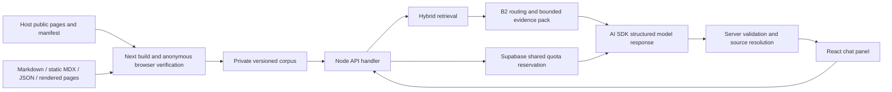

# Architecture and data flow

Portfolio AI is a source kit for a Next.js App Router host. It does not require a particular portfolio, CSS framework or project registry. The host supplies a knowledge manifest, routes, and a typed chat configuration. Atlas shows a complete fictional integration.

`lib/knowledge/contract.ts` defines public and protected sources and the corpus contract. The publisher runs the host's Next build, extracts records, checks anonymously that the declared page is public and visible, and packages `.portfolio-knowledge/corpus.json` with the matching Next build ID. Its static Markdown, MDX and JSON adapters parse data rather than execute it. MDX with JSX, expressions or imports is rejected; use the rendered adapter for dynamic content. The browser adapter captures visible public text and checks source URLs, anchors, indexability and protected markers. Protected sources and descendants are excluded. Large sections are chunked; stable identifiers and content hashes connect citations to the generated corpus. The corpus must stay server-only.

At request time, the server validates conversation and page context and ranks approved passages with a shared hybrid retriever. Orama supplies keyword scores and the local multilingual encoder supplies semantic similarity. The server reuses passage embeddings for the current corpus. A verified text selection can become an additional quoted source after it matches an eligible public passage. The model receives bounded evidence and produces structured claims with request-local evidence keys. The server validates those keys and reconstructs source URLs and recommendations from published records. Follow-up turns provide conversational context.

The panel provides direct questions, selection, follow-ups and navigation. Shared Supabase quota is reserved before the model call; anonymous events contain only limited metadata and token/latency counts. The code keeps historical `vincent_ai` database identifiers for compatibility with existing migrations; they are names, not portfolio content.

Structural validation cannot prove that a statement is entailed by a citation. Attribution and audience heuristics address known failure cases but do not replace manual evaluation. Review actual answers and cited passages before deployment.

## Reused libraries

The implementation uses [Next.js](https://nextjs.org/), [React](https://react.dev/), [Orama](https://github.com/oramasearch/orama), the [Vercel AI SDK](https://github.com/vercel/ai), [Puppeteer](https://pptr.dev/), [unified and remark](https://unifiedjs.com/), [Zod](https://zod.dev/) and [Lucide](https://lucide.dev/). Dependencies are installed separately; review their licenses and transitive notices for your own distribution. Exact test versions are in the Atlas lockfile.

See [Portfolio AI internal architecture V2](architecture-v2.md) for the shared answer engine, evidence eligibility, runtime limits and knowledge publication lifecycle.
