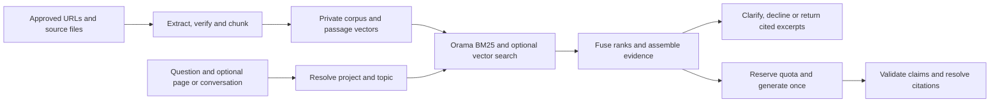

# Architecture and data flow

Portfolio AI builds a private search index from approved public sources. A shared Node.js engine serves the Next.js React panel, the Hosted widget and the Vite local preview. The engine takes a corpus, a question and configuration. Each integration supplies its own HTTP access controls and UI.

## 1. Publish knowledge

An exact URL list is sufficient for Hosted and Vite preview. A manifest can combine rendered pages, Markdown, static MDX and JSON. An entry declares its public URL, language, page kind and, when applicable, a project ID and heading anchors. The publisher verifies anonymously that the declared text and anchors are visible at the same-origin URL. It excludes protected paths and their descendants, hidden content and indexing exclusions. File adapters read from the integration root. Static MDX accepts plain content with headings. Dynamic content can use the rendered adapter when it is available in the anonymous capture.

Versioned chunks keep their project, language, section and canonical URL. On Hybrid builds the publisher encodes passage text in batches and writes base64-encoded Float32 vectors alongside the corpus in the same private artifact. The vector index records its version, model ID, dimensions and content hash. Next.js also binds the corpus to its Next build ID. Keep the artifact out of public directories and Git.

Hosted publishes a fresh snapshot on each assistant build. A publishing hook can trigger that build after the portfolio reports a successful production deployment. The approved source list controls what a refresh reads. A failed build leaves the last successful deployment serving. Native Next.js refreshes alongside the host build. Vite preview needs an explicit capture and restart.

## 2. Retrieve and assemble evidence

The engine validates the current page and selected text against the approved corpus. It resolves project names, aliases and references using the latest question and, when available, earlier turns. A verified current project can resolve a bare reference. An unresolved reference returns a clarification. Explicit project names take priority over older context. Topic detection guides evidence selection and leaves a general search path for open-ended questions.

Orama supplies full-text BM25 scores. The configured embedding provider encodes the question and cosine similarity finds passages with related meaning. A corpus and model match reuses the published passage vectors. Older or incompatible indexes can be regenerated in memory once per corpus and provider per running instance. The runtime can fall back to a unique literal match if the configured encoder fails to load.

The retriever uses weighted Reciprocal Rank Fusion to order qualified keyword and vector candidates. Exact public phrases receive priority. Qualification uses model-specific similarity thresholds and lexical support. The evidence stage keeps current public chunks, removes duplicate passages, respects explicit project scope and caps context size. A comparison needs relevant evidence for each project. A similar passage can be insufficient to answer a specific question about a cost, person, research topic or outcome. [Reciprocal Rank Fusion paper](https://cormack.uwaterloo.ca/cormacksigir09-rrf.pdf)

### Retrieval modes

| Setting | Runtime behavior |
| --- | --- |
| Default / `PORTFOLIO_RETRIEVAL_MODE=hybrid` | BM25 and a pinned quantized multilingual MiniLM encoder. |
| `PORTFOLIO_RETRIEVAL_MODE=keyword` | Local BM25 and lexical checks. The build and runtime skip embedding downloads and inference. Next.js file tracing excludes cached models and native embedding dependencies. |

Hosts extending the engine can provide an `EmbeddingProvider` through the Next.js publisher configuration and the server's `PortfolioChatConfig`. Use the same provider at publication and serving time. Its cache identity must change when the model, preprocessing or vector format changes. The interface takes query or passage text and returns finite unit-normalized vectors with fixed dimensions. It includes qualification thresholds because cosine score distributions vary by model. The shared retriever is the extension point for future candidate reranking. The shipped modes use in-process ranking and storage.

## 3. Answer and validate

Excerpt and generated replies use the same retrieval engine. Sites using the default setup return Hybrid excerpts and server-owned source links without model credentials. Enabling generation adds a quota reservation and one provider call for supported requests. A clarification, unsafe request or insufficient evidence returns before that reservation. The generator receives approved passages, evidence identifiers and limited question context. The prompt treats these inputs as untrusted data and asks for structured claims, evidence keys and short follow-up suggestions.

The server accepts evidence keys only from the current pack and rebuilds citation links from approved sources. It checks project scope, numbers, negation and personal contribution when supported by the available evidence. Selection questions require a verbatim match in an eligible passage. When Hosted cannot reserve quota or the provider fails, it can reuse that same pack for cited excerpts. The native Next.js endpoint retains its explicit HTTP errors for configured-model quota and provider failures.

## 4. Integrate and operate

Use the existing Hosted script with a public site on a framework that can load the script and frame, or the Next.js Registry item for an in-app React panel and typed API routes. The Vite preview runs on loopback and uses the same widget assets and core. The widget submits one question and the current approved route at a time. The native panel can send a bounded conversation and display validated follow-up suggestions.

Excerpt mode needs no model key or database. Hosted generation can use a Vercel Firewall limit or the existing Supabase quota, depending on deployment. Native generated mode uses the existing shared quota. Qwen is the default generation provider when enabled. OpenAI and AI Gateway are alternatives with host configuration and applicable access policies. [Integration](integration.md) · [Security and deployment](security.md)

The shipped Vercel install command skips ONNX's optional CUDA download. Hybrid bundles include the pinned model and retain one lazy CPU session per instance. Inference uses at most two CPU threads, capped by the parallelism reported by Node.js. Builds and requests each consume the applicable hosting allowances. Vercel meters Function memory by provisioned capacity and time. [Vercel Function limits](https://vercel.com/docs/functions/limitations) · [Fluid compute usage](https://vercel.com/docs/functions/usage-and-pricing)

`PORTFOLIO_AI_TIMING=1` emits numeric timings for knowledge, retrieval, evidence assembly and generation, plus provider token counts when available. These logs omit requests, passages and answers. Hosted does not persist questions or analytics events. Next.js can opt into metadata events with `PORTFOLIO_AI_ANALYTICS=1`. Provider requests include the current question and bounded evidence and are subject to that provider's terms.

## Compatibility and limits

- Published builds reuse passage vectors. Older schema-v1 corpora are accepted if their published content is valid. Publish again when changing the source list or model for predictable startup and latency.
- Ingested locales are English, Chinese and Japanese. Keyword-only cannot reliably match paraphrases or a query in another language. Hybrid recall still depends on the encoder, corpus quality and evidence rules.
- Source citations and heuristic consistency checks improve traceability. They cannot guarantee factual entailment or catch every unsupported claim and injection attempt.
- Reader URLs must satisfy the source contract and render their content using allowed resources. The in-memory search index is designed for small site corpora. Hosted excerpt limits are per process, and local inference uses host CPU and memory.

See [the V2 architecture record](architecture-v2.md) for the previous implementation and [evaluation](evaluation.md) for regression and troubleshooting workflows.
